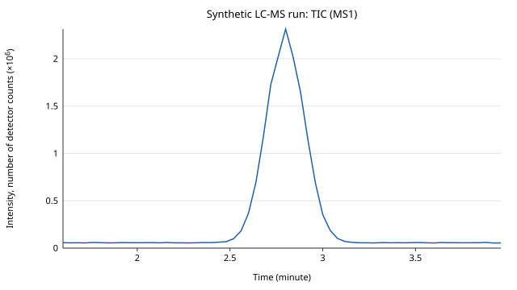
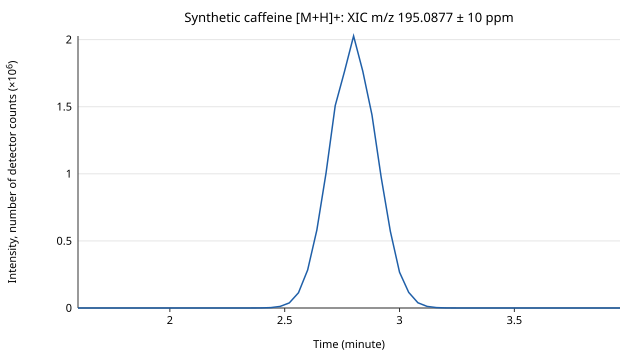

# mzML reader, validator and writer

A small, dependency-free Python toolkit for **mzML**, the open HUPO-PSI XML format for mass spectrometry data: a streaming reader, a validator, chromatogram tools (TIC, BPC, XIC, with CSV and SVG output) and a minimal writer.

**Problem it solves:** mzML stores each spectrum's metadata as controlled-vocabulary terms and its m/z and intensity values as base64-encoded, optionally compressed binary arrays. A file can hold thousands of spectra, so loading the whole XML tree at once doesn't scale. This reader **streams** the file one spectrum at a time, decodes the binary arrays, checks every declared array length, and stops with a readable error on anything it doesn't support, instead of returning wrong numbers. The validator goes further: it checks a file's **internal consistency** (counts, cross-references, array contents, and the index offsets and checksum of indexed files) and reports every problem it finds, each with a stable code. The chromatogram tools turn the spectra into the traces usually looked at first (total ion current, base peak, extracted ion), and **compare the computed TIC with what the file declares** instead of trusting either. The writer closes the loop: what it writes reads back to the same values and passes the validator.

**Educational, not production:** for production work, established open-source libraries exist (pyteomics, pymzML, pyOpenMS). This is a small toolkit built to show how the format works, using only the Python standard library.

## Approach

Implemented from the published HUPO-PSI mzML 1.1 specification and the PSI-MS controlled vocabulary. Every CV term is used by name **and** accession, and all of them are kept in one module, [`psi_ms_cv.py`](psi_ms_cv.py).

### Reader (`mzml.py`)

| Feature | Details |
|---|---|
| Wrappers | Plain `<mzML>` and `<indexedmzML>`. The reader skips the index: spectra are read in document order (the validator checks the index) |
| Streaming | `xml.etree.ElementTree.iterparse`. Each spectrum or chromatogram is yielded as soon as it ends, then its element is freed, so memory stays flat as files grow (the tests check this) |
| Binary arrays | base64; no compression or zlib; 32-bit or 64-bit little-endian floats. Values come back as `array('d')` |
| Per spectrum | id, index, MS level, centroid or profile, scan start time and its unit, m/z and intensity arrays (with the intensity unit), total ion current, and precursors (isolation window, selected ion m/z, charge, intensity, activation, collision energy) |
| Chromatograms | id, index, type (e.g. *total ion current chromatogram*), time array and its unit, intensity array and its unit |
| Param groups | `referenceableParamGroupRef` is expanded where it's used |
| Errors | `MzMLError` with the spectrum id and array name for: MS-Numpress or any other compression except zlib, a missing or unsupported array type or data type, a missing compression term, a decoded length that doesn't match `defaultArrayLength`/`arrayLength`, a wrong `encodedLength`, invalid base64 or zlib data, and malformed XML |

### Validator (`mzml_validator.py`)

One streaming pass over the file (same memory behaviour as the reader), plus a few seeks to check the index of an indexed file. Every finding has a code, a level and a message that names the spectrum or chromatogram concerned. `--strict` (or `strict=True`) turns warnings into errors.

The levels (error or warning) are this tool's own choices for consistency checks. A file that passes is not thereby certified as conforming to the mzML specification; the official PSI validator does that.

| Code | Level | Check |
|---|---|---|
| MZV001 | error | Well-formed XML with an `<mzML>` or `<indexedmzML>` root |
| MZV002 | error | Required top-level elements present: `cvList`, `fileDescription`, `softwareList`, `instrumentConfigurationList`, `dataProcessingList`, `run` |
| MZV003 | error | Every `cvRef` / `unitCvRef` is declared in `cvList` |
| MZV004 | error | Every `referenceableParamGroupRef` resolves |
| MZV005 | error | Every `instrumentConfigurationRef` resolves (run default and per scan) |
| MZV006 | error | Every `dataProcessingRef` resolves (list defaults, spectra, chromatograms, arrays) |
| MZV010 | error | `spectrumList` / `chromatogramList` `count` matches the number of elements |
| MZV011 | error | `index` values are consecutive from 0 |
| MZV012 | error | Spectrum ids and chromatogram ids are unique |
| MZV020 | error | Each array's decoded length equals `defaultArrayLength` / `arrayLength` |
| MZV021 | error | Each binary array can be decoded: known array type, 32/64-bit float, zlib or no compression, valid base64 and zlib data |
| MZV022 | error | `encodedLength` matches the base64 text |
| MZV023 | error | Required arrays present: m/z + intensity in a spectrum, time + intensity in a chromatogram |
| MZV024 | error | A spectrum's m/z and intensity arrays have the same length |
| MZV030 | warning | A spectrum states *centroid spectrum* or *profile spectrum* |
| MZV031 | error | The m/z array is non-decreasing |
| MZV032 | warning | Intensities are non-negative |
| MZV033 | error | A spectrum states its MS level |
| MZV034 | error | An MS2 (or higher) spectrum has a precursor |
| MZV040 | error | A chromatogram's time and intensity arrays have the same length |
| MZV041 | error | A chromatogram's time array is non-decreasing |
| MZV050 | error | Indexed files: each index offset points exactly at the `<spectrum` or `<chromatogram` start with that id |
| MZV051 | error | Indexed files: `indexListOffset` points at `<indexList>` |
| MZV052 | error | Indexed files: the SHA-1 `fileChecksum` matches the file (from its start to the end of the `<fileChecksum>` tag) |
| MZV053 | warning | Indexed files: every spectrum and chromatogram is in the index |

### Chromatograms (`mzml_chromatograms.py`)

One streaming pass builds every trace from the **MS1 spectra** (MS2 and higher are skipped and counted):

| Trace | Value per MS1 spectrum |
|---|---|
| TIC | Sum of all intensities |
| BPC | Largest intensity, with the m/z of that peak |
| XIC | Sum of the intensities inside an m/z window: centre ± tolerance, in ppm or Da (bounds included) |

- **Units as stored:** times keep the unit of the file (`minute`, `second`). Mixed units within one file are an error, not a silent conversion.
- **TIC cross-check:** the computed TIC is compared with the file's own *total ion current chromatogram* and with each spectrum's *total ion current* value, when present. Points are matched by time; values that differ by more than a relative tolerance (default 1e-5), points with no matching MS1 spectrum, and differing units are all reported. Neither side is trusted silently.
- **Output:** `Trace` objects (times and unit, intensities and unit, base peak m/z for the BPC, the spectrum ids), CSV with one row per MS1 spectrum, and an **SVG line plot** with labelled axes and units, written with the standard library only. A trace can also become a `Chromatogram` for the writer.

### Writer (`mzml_writer.py`)

Writes `Spectrum` and `Chromatogram` objects, as the reader returns them or built by hand, to mzML 1.1:

| Feature | Details |
|---|---|
| Wrappers | Plain `<mzML>`, or `<indexedmzML>` with a byte offset for every spectrum and chromatogram, `indexListOffset` and the SHA-1 `fileChecksum` |
| Arrays | 64-bit floats by default (32-bit on request); zlib or no compression |
| Values | Numbers are written with Python's `repr`, so 64-bit values read back exactly |
| Metadata | Generic PSI-MS terms only (*instrument model*, *custom unreleased software tool*, *data processing action*) |
| Input checks | `ValueError` for anything that would make an invalid or ambiguous file: duplicate or empty ids, a missing MS level or centroid/profile flag, an MS2 spectrum without a precursor, arrays of unequal length, decreasing m/z or time, negative intensities, NaN, and units, chromatogram types or activations it has no CV accession for |

Every file it writes reads back to the same values and passes `mzml_validator.py --strict` with no findings (the tests check both, for every encoding combination and for all three sample files).

**Out of scope:** XSD schema validation; the full mzML semantic mapping rules (which CV terms are allowed or required where; the official PSI semantic validator does that); MS-Numpress and other compression schemes (rejected by the reader, reported as undecodable by the validator, never written); integer and string arrays; array types other than m/z, intensity and time; instrument-specific metadata in written files; peak detection, smoothing and integration of chromatograms; time-unit conversion; random access through the index; and any other file format.

## Data

Everything in `sample-data/` is **synthetic**, generated by `generate_synthetic_mzml.py` with a fixed seed. The model compound is caffeine (C8H10N4O2, [M+H]+ at m/z 195.0877). Its isotope pattern is computed in the script from natural isotopic abundances. The elution profile, intensities, background ions and noise are invented. Instrument metadata uses generic PSI-MS terms only (*instrument model*, electrospray ionization, quadrupole, electron multiplier), with no instrument model named.

| File | Contents |
|---|---|
| `synthetic_caffeine_lc_ms_centroid.mzML` | A simulated LC-MS run: 60 centroid MS1 spectra (1.60 to 3.96 min) with a Gaussian elution peak at 2.80 min. 64-bit floats, zlib. Includes a total ion current chromatogram |
| `synthetic_caffeine_profile.mzML` | 5 profile-mode MS1 spectra of the [M+H]+ region (m/z 193.5 to 199.5, 1201 points each). 32-bit floats, no compression |
| `synthetic_caffeine_ms2_indexed.mzML` | `indexedmzML` wrapper with valid byte offsets and SHA-1 checksum: 3 MS1 + 3 MS2 spectra of m/z 195.0877, with precursor information and illustrative product ions. 64-bit m/z and 32-bit intensities, zlib. Includes a total ion current chromatogram, which covers all six spectra (MS1 and MS2) |

The three files validate against the official mzML 1.1 XML schemas. That check was run when the files were generated; it isn't part of the tests, because it needs a third-party XML library. They also pass `mzml_validator.py --strict` with no findings.

`sample-data/invalid/` holds deliberately broken copies, generated by `generate_invalid_mzml.py`. Each one rebuilds a valid file with the same seed and adds **exactly one** defect:

| File | Defect | Expected finding |
|---|---|---|
| `invalid_spectrum_count.mzML` | `spectrumList count="6"`, but the list holds 5 spectra | MZV010 |
| `invalid_array_length.mzML` | One intensity array declares `arrayLength="1200"` but holds 1201 values | MZV020 |
| `invalid_duplicate_id.mzML` | The second spectrum reuses the first spectrum's id | MZV012 |
| `invalid_mz_order.mzML` | Two neighbouring m/z values swapped in the first spectrum | MZV031 |
| `invalid_index_offset.mzML` | One index offset is 1 byte too far (checksum recomputed, so only the offset is wrong) | MZV050 |
| `invalid_checksum.mzML` | The SHA-1 `fileChecksum` doesn't match the file | MZV052 |

`sample-data/output/` holds two example plots, drawn by `generate_example_plots.py` from the simulated LC-MS run:

| TIC (MS1) | XIC of caffeine [M+H]+, m/z 195.0877 ± 10 ppm |
|---|---|
|  |  |

## Run

```bash
pip install -r requirements.txt          # pytest, for the tests only; the tools need nothing else

# summary of each file (exit code 1 if a file can't be read)
python mzml.py sample-data/*.mzML

# validate (exit code 1 if any file has errors; --strict turns warnings into errors)
python mzml_validator.py sample-data/*.mzML sample-data/invalid/*.mzML
python mzml_validator.py --strict sample-data/*.mzML

# chromatograms: summary + TIC check; XIC windows as MZ[,TOL[,ppm|Da]] (default 10 ppm)
python mzml_chromatograms.py sample-data/synthetic_caffeine_lc_ms_centroid.mzML --xic 195.0877,10,ppm \
    --csv traces.csv --svg xic.svg
python mzml_chromatograms.py sample-data/synthetic_caffeine_lc_ms_centroid.mzML --svg tic.svg --plot tic

# regenerate the synthetic sample files, the invalid copies and the example plots
python generate_synthetic_mzml.py
python generate_invalid_mzml.py
python generate_example_plots.py

# unit tests
python -m pytest -q

# traceability matrix from a test run's JUnit report (see Test plan and traceability)
python -m pytest -q --junitxml=junit.xml
python traceability/build_matrix.py junit.xml --out traceability-matrix.md
```

```
sample-data/synthetic_caffeine_ms2_indexed.mzML
  format        : indexed mzML (run 'synthetic_caffeine_ms2_indexed')
  spectra       : 6 (MS1: 3, MS2: 3), centroid
  scan time     : 2.7 to 2.81 minute
  m/z           : 56.0494 to 355.5350
  chromatograms : 1: TIC (total ion current chromatogram, 6 points)
```

Validator output for a valid file and a broken one:

```
sample-data/synthetic_caffeine_ms2_indexed.mzML
  format     : indexed mzML, 6 spectra, 1 chromatogram(s)
  validation : OK
sample-data/invalid/invalid_index_offset.mzML
  format     : indexed mzML, 6 spectra, 1 chromatogram(s)
  validation : 1 error(s)
    ERROR: MZV050: spectrum 'scan=3': index offset 10211 does not point at <spectrum ... id="scan=3">
```

Chromatogram output for the simulated LC-MS run, and for the indexed file, whose declared TIC also covers its MS2 spectra:

```
sample-data/synthetic_caffeine_lc_ms_centroid.mzML
  MS1 spectra : 60, 1.6 to 3.96 minute (0 other spectra skipped)
  TIC         : max 2.31462e+06 at 2.8 minute
  BPC         : max 2.02705e+06 at 2.8 minute (m/z 195.0872)
  XIC m/z 195.0877 +/- 10 ppm: max 2.02705e+06 at 2.8 minute  [window 195.0857 to 195.0897]
  TIC check   : OK: declared TIC chromatogram 'TIC': 60 point(s) compared, 0 differ (max relative difference 1.3e-16)
  TIC check   : OK: spectrum total ion current: 60 point(s) compared, 0 differ (max relative difference 1.3e-16)
sample-data/synthetic_caffeine_ms2_indexed.mzML
  MS1 spectra : 3, 2.7 to 2.8 minute (3 other spectra skipped)
  TIC         : max 2.1811e+06 at 2.75 minute
  BPC         : max 1.93544e+06 at 2.75 minute (m/z 195.0877)
  TIC check   : DIFFERENCE: declared TIC chromatogram 'TIC': 3 point(s) compared, 0 differ (max relative difference 3.6e-08); 3 declared point(s) have no MS1 spectrum at that time (the declared TIC may include MS2 or higher spectra)
  TIC check   : OK: spectrum total ion current: 6 point(s) compared, 0 differ (max relative difference 2.3e-08)
```

From Python:

```python
import mzml
import mzml_chromatograms
import mzml_validator
import mzml_writer

for sp in mzml.iter_spectra("sample-data/synthetic_caffeine_ms2_indexed.mzML"):   # one at a time
    sp.id, sp.ms_level, sp.centroid          # 'scan=2', 2, True
    sp.scan_start_time_unit                  # 'minute'
    sp.mz, sp.intensity                      # array('d', [...])
    if sp.precursors:
        sp.precursors[0].selected_ion_mz     # 195.08765

run = mzml.read("sample-data/synthetic_caffeine_lc_ms_centroid.mzML")   # whole file in memory
run.indexed, len(run.spectra), run.chromatograms[0].kind

report = mzml_validator.validate("sample-data/invalid/invalid_mz_order.mzML")
report.ok, report.codes                      # False, ['MZV031']
for finding in report.findings:
    print(finding)                           # ERROR: MZV031: spectrum 'scan=1': m/z decreases at point 11 ...

result = mzml_chromatograms.extract("sample-data/synthetic_caffeine_lc_ms_centroid.mzML",
                                    [(195.0877, 10, "ppm")])
result.xics[0].apex()                        # (2.8, 2027047.5): time in minutes, intensity
[str(check) for check in result.checks]      # TIC cross-check against the file's declared values
svg = mzml_chromatograms.svg_plot(result.tic)

mzml_writer.write("copy.mzML", run.spectra, run.chromatograms + [result.bpc.to_chromatogram("BPC", 1)],
                  indexed=True, zlib_compressed=True)
mzml.read("copy.mzML").spectra == run.spectra                          # True
mzml_validator.validate("copy.mzML", strict=True).findings             # []
```

## Testing status

Tested only on the synthetic files generated by the included scripts, and on small in-memory documents in the tests (one per error case or check). It has not been run on files from real acquisitions.

The reader tests cover a round trip for each encoding combination (32/64-bit, with and without zlib), every error path listed above, streaming behaviour (the first spectrum arrives before the file has been read, and peak memory doesn't grow with the number of spectra), plain and indexed files, chromatograms, and generator determinism.

The validator tests cover every check code, each with a passing case (a valid document yields no findings) and a failing case (one targeted edit yields exactly that code), plus: each invalid sample yields exactly its documented finding, the valid samples yield none, the invalid samples are reproducible, `--strict`, and the command-line exit codes.

The chromatogram tests check TIC, BPC and XIC against sums computed directly from the spectra; that the caffeine XIC peaks at the 2.80 min elution apex and a window away from the compound stays at zero; that ppm and Da tolerances of the same width give the same trace; the edge cases (an empty window, an empty spectrum, a file with no MS1 spectra, MS2 spectra excluded, units kept as stored, mixed units refused); every outcome of the TIC cross-check; the CSV columns; that the SVG plots are well-formed, labelled and byte-identical on every run; and the command line.

The writer tests round-trip every combination of 32/64-bit, zlib or not, and plain or indexed, plus all three sample files, and check that each output passes `mzml_validator.py --strict`, that the index offsets and checksum are correct, and that every kind of invalid input is refused.

In CI, the `tests` workflow runs the full suite on Python 3.9, 3.10, 3.11, 3.12, 3.13, 3.14 and 3.15 on every push to `main` and on pull requests. Before the workflow was added, the suite passed on all seven versions in Docker (`python:3.x-slim`, 2026-10-23).

## Test plan and traceability

- **Test plan:** [`docs/test-plan.md`](docs/test-plan.md): scope, a risk-based approach, environments, entry and exit criteria, and the known gaps.
- **Requirements:** [`traceability/requirements.tsv`](traceability/requirements.tsv): 38 requirements with their source: 37 are claims made in this README, one (TR-01) covers the traceability tooling itself.
- **Links:** every test carries `@pytest.mark.req(...)` with the requirement ids it verifies. `conftest.py` writes them into the JUnit XML report.
- **Matrix:** [`traceability/build_matrix.py`](traceability/build_matrix.py) builds the requirements → tests → results matrix from a real JUnit report. It lists requirements without tests and tests without requirements, and rejects unknown ids. The CI workflow builds it for every Python version, as an artifact next to the JUnit reports.
- **Snapshot:** [`docs/traceability-matrix.md`](docs/traceability-matrix.md) is one generated matrix, committed as a snapshot. Its header records when, from what and on which Python version it was generated. It is regenerated, never edited by hand.

One requirement has no automated test yet: the reader's command-line summary (RD-11). It is listed in the matrix and in the test plan's known gaps.

## Notes

- **Reproducibility:** re-running the generators reproduces the files byte for byte with the same zlib build. Another zlib implementation can compress the same bytes differently. The decoded values (and, for the invalid samples, the findings) are the same either way, and the tests compare those. The four invalid files built from the uncompressed profile sample, and the two SVG plots, are byte-identical everywhere.
- **Units:** `scan_start_time` is returned as stored, with its unit (`minute` or `second`). Nothing is converted.
- **Reader vs validator:** the reader stops at the first problem it can't read past. The validator keeps going and reports everything it finds, so one file can produce several findings.
- **Declared vs computed TIC:** a file's TIC chromatogram may sum all spectra, or only MS1 spectra. The computed TIC here is MS1 only, so for the indexed sample the check reports its three MS2 time points as extra, rather than guessing which convention the file used.
- Requires Python ≥ 3.9. Standard library only.
